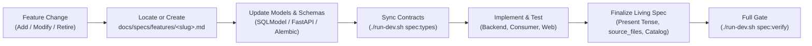

# Living Specifications Guide

Welcome to the **dispatch-map** specification repository. All active product capabilities and platform contracts follow **Living Spec-Driven Development**.

---

## Core Principle

> **Specs describe the system as it works today, not a chronological log of past tickets.**
> Every capability owns one present-tense file under `docs/specs/features/`. When behavior changes, that spec is updated in place in the same branch or PR as the code—git history tracks how it evolved over time.

---

## Directory Structure

```text
docs/specs/
├── README.md                              # Living spec guide & feature catalog
├── architecture.md                        # System topology, canonical ERD, API/TS pipeline & SPA hosting
├── templates/
│   └── feature_spec_template.md           # Standardized template for living feature specs
└── features/                              # One living spec per vertical capability (kebab-case)
    ├── active-calls-ingestion.md
    ├── location-geocoding.md
    ├── events-feed.md
    ├── interactive-map.md
    ├── event-details-and-responders.md
    └── radio-transcriber.md
```

Cross-cutting contracts—monorepo topology, SQLModel/PostgreSQL tables and indexes, OpenAPI-to-TypeScript generation, and production SPA hosting—live in [architecture.md](architecture.md).

---

## Feature Catalog

Every file in `docs/specs/features/` must appear in this table (enforced by `./run-dev.sh spec:check`).

| Feature | Spec File | Status | Packages | Summary |
|---|---|---|---|---|
| `active-calls-ingestion` | [active-calls-ingestion.md](features/active-calls-ingestion.md) | `active` | `packages/db`, `packages/dispatch-consumer`, `packages/migrations` | Polls Richmond active calls HTML, groups responders by `external_id`, and records monotonic status progressions |
| `location-geocoding` | [location-geocoding.md](features/location-geocoding.md) | `active` | `packages/db`, `packages/dispatch-consumer` | Normalizes CAD location text and caches bounded Nominatim coordinates in PostgreSQL |
| `events-feed` | [events-feed.md](features/events-feed.md) | `active` | `packages/api`, `packages/web`, `packages/db` | Serves `GET /events` and renders the live-polling, time-windowed, searchable incident sidebar |
| `interactive-map` | [interactive-map.md](features/interactive-map.md) | `active` | `packages/web` | Plots geocoded calls on a Leaflet map with category-colored markers and camera sync |
| `event-details-and-responders` | [event-details-and-responders.md](features/event-details-and-responders.md) | `active` | `packages/api`, `packages/web`, `packages/db` | Serves `GET /events/{external_id}/responders` and displays incident metadata with responder status timelines |
| `radio-transcriber` | [radio-transcriber.md](features/radio-transcriber.md) | `experimental` | `performance/radio-transcriber` | Rust service that decodes local audio samples via FFmpeg into 16kHz `s16le` PCM chunks over an MPSC channel with optional real-time pacing |

---

## Living Spec Lifecycle



### 1. Adding a New Feature
1. Choose a descriptive kebab-case slug (`<feature-slug>`, never numeric prefixes like `001-`).
2. Copy [feature_spec_template.md](templates/feature_spec_template.md) to `docs/specs/features/<feature-slug>.md`.
3. Fill out the YAML frontmatter (`feature`, `title`, `status`, `packages`, `source_files`, `tests`) and the five required sections in present tense.
4. Register the new feature row in the **Feature Catalog** table above linking `features/<feature-slug>.md`.
5. Implement database/API schema updates first, regenerate TypeScript contracts (`./run-dev.sh spec:types`), write tests, and verify (`./run-dev.sh spec:verify`).

### 2. Modifying an Existing Feature
1. Find the owning living spec via the **Feature Catalog** above (or by searching `source_files` in `docs/specs/features/`).
2. Read the current spec before editing code so invariants and edge cases are clear.
3. Update the spec **in place** in the same branch/PR: revise requirements, interfaces, edge cases, `source_files`, and `tests` to reflect the new steady state. If shared tables, topology, or SPA routing changed, also update [architecture.md](architecture.md).
4. If API schemas or endpoints changed, run `./run-dev.sh spec:types` to update `packages/api/openapi.json` and `packages/web/src/types/api.generated.ts`.
5. Run `./run-dev.sh spec:verify` before committing.

### 3. Retiring a Feature
1. Remove the feature's implementation, schemas, and tests (and run `./run-dev.sh spec:types` if API routes changed).
2. Delete `docs/specs/features/<feature-slug>.md` and remove its row from the **Feature Catalog** table above (do **not** create a `"retire-*"` spec file—git history preserves the removal).
3. Run `./run-dev.sh spec:verify`.

---

## Verification Commands

- `./run-dev.sh spec:check` — Validates living spec structure, YAML frontmatter, required headings, catalog sync, `source_files`/`tests` paths, and relative markdown links.
- `./run-dev.sh spec:export` — Exports `packages/api/openapi.json` offline from FastAPI.
- `./run-dev.sh spec:types` — Exports OpenAPI JSON and regenerates `packages/web/src/types/api.generated.ts`.
- `./run-dev.sh spec:verify` — Runs all 6 verification gates: `spec:check`, API unit tests, DB model tests, consumer parser tests, OpenAPI/TypeScript contract sync check, and frontend build + lint.
