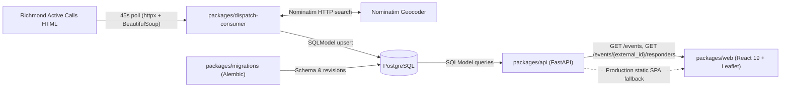
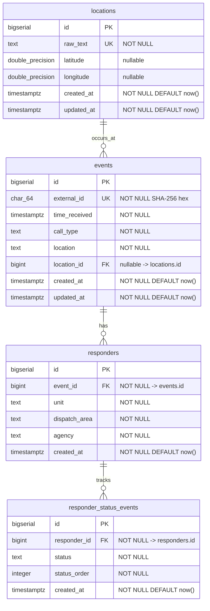

# Dispatch Map — Shared Architecture & Data Model

This document is the canonical cross-cutting reference for **dispatch-map**, covering system topology, the PostgreSQL/SQLModel data model, the API-to-TypeScript contract pipeline, and the React SPA architecture. Feature-specific requirements live in [README.md](README.md) and `docs/specs/features/`.

---

## 1. System Topology



### Workspace Packages

| Package | Role | Key Stack |
|---|---|---|
| `packages/db` | Shared SQLModel ORM tables, domain constants (`STATUS_ORDER`), and deterministic `compute_external_id` helper | Python 3.14+, SQLModel, SQLAlchemy |
| `packages/migrations` | Authoritative PostgreSQL schema migrations | Alembic, SQLAlchemy |
| `packages/dispatch-consumer` | Background worker that polls Richmond active calls, groups events/responders, geocodes locations, and persists updates | `httpx`, `beautifulsoup4`, SQLModel |
| `packages/api` | REST API server and production single-port SPA static host | FastAPI, SQLModel, Uvicorn |
| `packages/web` | Interactive emergency dispatch map and call/responder inspector | React 19, TypeScript, Vite, Tailwind CSS v4, Radix UI, TanStack Query, Leaflet |
| `performance/` | Rust Cargo workspace scaffold (currently empty `[workspace]` manifest placeholder) | Cargo |

---

## 2. Canonical Data Model & ERD

Schema definitions live in [models.py](../../packages/db/src/db/models.py) and evolve via Alembic revisions in [32824efe6b6b_init.py](../../packages/migrations/alembic/versions/32824efe6b6b_init.py) and [58d821ac9576_status_order.py](../../packages/migrations/alembic/versions/58d821ac9576_status_order.py) (which supersede the baseline [001_schema.sql](../../docker/postgres/init/001_schema.sql) by adding `responder_status_events.status_order`).



### Indexes

| Index Name | Table | Definition |
|---|---|---|
| `idx_events_external_id` | `events` | `(external_id)` |
| `idx_events_time_received` | `events` | `(time_received DESC)` |
| `idx_responders_event_id` | `responders` | `(event_id)` |
| `idx_responder_status_events_responder_id` | `responder_status_events` | `(responder_id, created_at DESC)` |

### Domain Invariants

- **Event Identity (`compute_external_id`)**:
  `events.external_id` is a 64-character lowercase hex SHA-256 digest computed in [models.py](../../packages/db/src/db/models.py) as:
  ```python
  sha256(f"{time_received}|{call_type}|{location}".encode()).hexdigest()
  ```
  Because `unit` and `agency` are excluded from the hash, multiple responding units for the same incident share a single `events` row (`1:N` `events` -> `responders`).
- **Status Ordering (`STATUS_ORDER`)**:
  Canonical progression order in [models.py](../../packages/db/src/db/models.py):
  - `DISPATCHED` -> `1`
  - `ENROUTE` -> `2`
  - `ARRIVED` -> `3`
  - Unrecognized status strings default to `0`.
- **Append-Only Status Timeline**: Responder status transitions are appended as new `responder_status_events` rows rather than overwriting prior state.

---

## 3. API Contract & Type Generation Pipeline

`packages/api` is the single source of truth for REST contracts consumed by `packages/web`. Never hand-author duplicate TypeScript interfaces representing backend response schemas.

```mermaid
flowchart LR
    Schemas["packages/api/schemas.py & routers/"] -->|"`./run-dev.sh spec:export`"| OpenAPI["packages/api/openapi.json"]
    OpenAPI -->|"`./run-dev.sh spec:types` (openapi-typescript)"| GeneratedTS["packages/web/src/types/api.generated.ts"]
    GeneratedTS --> FeatureTypes["packages/web/src/features/events/types/index.ts"]
```

1. Define or update SQLModel response models in [schemas.py](../../packages/api/schemas.py) and route handlers in `packages/api/routers/`.
2. Run `./run-dev.sh spec:types` to invoke [export_openapi.py](../../packages/api/export_openapi.py) (writing [openapi.json](../../packages/api/openapi.json)) and regenerate [api.generated.ts](../../packages/web/src/types/api.generated.ts) via `openapi-typescript`.
3. Import generated types in `packages/web` through feature type aliases (such as `packages/web/src/features/events/types/index.ts`).
4. Contract drift is rejected by `./run-dev.sh spec:verify` (`openapi-typescript --check`).

---

## 4. Frontend Architecture & Unified SPA Hosting

### Web Directory Structure

The frontend follows a feature-sliced layout under `packages/web/src/`:

- `pages/`: Page-level state orchestration ([dispatch-page.tsx](../../packages/web/src/pages/dispatch-page.tsx)).
- `features/events/`: Dispatch feed and responder timeline domain (`api/`, `components/`, `types/`).
- `features/map/`: Leaflet map and incident marker domain (`components/`).
- `components/layout/`: Application shell (`app-layout.tsx`, `app-header.tsx`).
- `components/ui/`: Tailwind CSS v4 + Radix UI primitives (`badge`, `button`, `card`, `input`, `scroll-area`, `select`).
- `lib/`: Shared TanStack Query client ([query-client.ts](../../packages/web/src/lib/query-client.ts)), time/category formatters (`formatters.ts`), and class-name helper (`utils.ts`).
- `types/`: Generated OpenAPI types ([api.generated.ts](../../packages/web/src/types/api.generated.ts)) and generic `ApiError` (`api.ts`).

### Development Proxy vs. Production SPA Hosting

- **Development**: Vite serves on port `5173` and proxies `/events` requests to `VITE_API_URL` (default `http://127.0.0.1:8000` locally or `http://api:8000` in Docker Compose), configured in [vite.config.ts](../../packages/web/vite.config.ts).
- **Production**: `npm run build --prefix packages/web` outputs bundled static assets to `packages/api/static/app`. FastAPI mounts `/static` and registers [spa.py](../../packages/api/routers/spa.py) after API routers:
  - `GET /{full_path:path}` resolves requested asset paths safely inside `APP_DIR` (`candidate.relative_to(APP_DIR.resolve())` rejects traversal with `404`).
  - Existing files are served via `FileResponse`; unknown client routes fall back to `index.html`.
  - If the frontend bundle has not been built (`index.html` missing), FastAPI returns `404` (`"Frontend not built. Run: npm run build --prefix packages/web"`).

