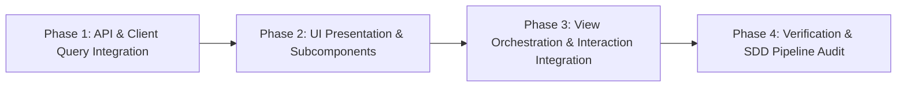

# Feature Specification: Event Details & Responders Display in Frontend

- **Status**: Draft | Under Review
- **Author**: AI Assistant & Pair
- **Date**: 2026-10-14
- **Related Issues / PRs**: N/A
- **Spec ID**: `003-event-details-responders-view`
- **Depends On**: `002-event-responders-endpoint`

---

## 1. Summary & Problem Statement

### Problem
In Feature 002 (`002-event-responders-endpoint`), the backend endpoint `GET /events/{external_id}/responders` was created and contracts were synchronized to `packages/web/src/types/api.generated.ts`. 

However, the frontend currently only highlights the selected event card in the sidebar list when a user clicks a pin on the map or an item in the list. There is no way for operators or public users to view rich incident metadata or inspect responding units (e.g. Engine 10, Medic 4) and their chronological progression through operational stages (`DISPATCHED` -> `ENROUTE` -> `ARRIVED`).

### Proposed Solution
When a user selects an incident—either by clicking an event card in the left sidebar or by clicking a marker pin on the Leaflet dispatch map:
1. The sidebar performs a **Full View Transition**: the event list is replaced by a large, comprehensive **Event Detail Card**.
2. A single, clear **"← Back to all calls"** navigation button at the top allows users to return immediately to the searchable event list (no "✕" close button is needed).
3. The card displays full incident details: call category badge, formatted time (relative and localized exact), full street address, coordinates / mapped status, and natural identifier (`external_id`) with a copy button.
4. The card queries the new `GET /events/{external_id}/responders` endpoint using TanStack Query to display assigned responder units, their agencies, current status, and an interactive vertical timeline stepper detailing each status progression event.

### User Stories / Use Cases
- **As an** emergency dispatch viewer or supervisor,
- **I want to** click any incident on the map or list and see full incident details alongside assigned units and their status history,
- **So that** I have immediate situational awareness of who responded and when they arrived.

- **As an** operator inspecting multiple incidents,
- **I want to** click "← Back to all calls" or press Escape to quickly return to my filtered incident list,
- **So that** my workflow is fast, frictionless, and preserves my previous search filter.

---

## 2. Scope Boundaries

### In Scope
- **API Client Layer (`packages/web/src/features/events/api`)**:
  - Re-export responder schema types in `features/events/types/index.ts`.
  - Add query key definition in `features/events/api/query-keys.ts`.
  - Implement fetcher `getEventResponders(externalId: string)` in `features/events/api/get-event-responders.ts`.
  - Implement TanStack Query hook `useEventRespondersQuery(externalId?: string | null)` in `features/events/api/use-event-responders-query.ts`.
- **UI Components (`packages/web/src/features/events/components`)**:
  - Create `ResponderCard` to display unit badges, agency/area tags, latest status, and chronological status progression steppers.
  - Create `EventDetailCard` containing the back button ("← Back to all calls"), incident metadata, coordinates, copy-able external ID, and responder list (with loading, error, empty, and populated states).
  - Update `EventList` to transition to `EventDetailCard` when an event is selected, while maintaining search filter state.
- **Page Orchestration (`packages/web/src/pages/dispatch-page.tsx`)**:
  - Connect selection state (`selectedEvent`) and deselect handler (`onBack`).
  - Add global `Escape` key event listener to deselect the active event and return to the list.
- **Verification**:
  - Verify complete SDD pipeline with `./run-dev.sh spec:verify`.

### Out of Scope (Deferred)
- **Live WebSocket / SSE responder streams**: Real-time push updates will be addressed in a future streaming spec; background polling (30s) is used here.
- **Backend Schema / Route changes**: Backend already satisfies contracts in Feature 002.
- **Secondary '✕' close button**: Dismissal is strictly handled by the top "← Back to all calls" button (and the `Escape` key shortcut).

---

## 3. Data Models & Interface Contracts

The frontend utilizes types already generated in `packages/web/src/types/api.generated.ts`:

```typescript
export interface components {
  schemas: {
    EventRespondersEnvelope: {
      external_id: string;
      responders: components["schemas"]["ResponderRead"][];
    };
    ResponderRead: {
      unit: string;
      dispatch_area: string;
      agency: string;
      created_at: string;
      statuses: components["schemas"]["ResponderStatusRead"][];
    };
    ResponderStatusRead: {
      status: string;
      status_order: number;
      created_at: string;
    };
    EventWithCoords: {
      id: number;
      external_id: string;
      time_received: string;
      call_type: string;
      location: string;
      location_id: number | null;
      latitude: number | null;
      longitude: number | null;
      created_at: string;
      updated_at: string;
    };
  };
}
```

---

## 4. Edge Cases, Failure Modes & Resilience

| Scenario | System Behavior | Expected UX / Feedback |
|---|---|---|
| Event has 0 responders dispatched | `GET /events/{external_id}/responders` returns 200 with `responders: []` | Renders empty state card: "No units dispatched to this incident" |
| Responder query is loading | TanStack Query `isLoading: true` | Renders animated loading skeleton / spinner |
| Responder API network error (500 or timeout) | TanStack Query `isError: true` | Renders error banner with message and manual "Retry" button |
| Event has no coordinates | `latitude: null, longitude: null` | Renders "⏳ Pending Geocoding" badge instead of coordinate pill |
| User presses `Escape` key | Keydown listener fires in `DispatchPage` | Clears `selectedEventId`, returning to list view |
| User clicks back after filtering | `searchQuery` retained in `EventList` | Returns to list with filtered results intact |
| Unit has multiple status events | Sorted chronologically by `status_order` / `created_at` | Stepper nodes connect in chronological order with elapsed step durations |

---

## 5. Implementation Phases

Implementation will proceed in four distinct, sequential phases:



### Phase 1: API & Client Query Integration
- Re-export responder contracts (`EventRespondersEnvelope`, `ResponderRead`, `ResponderStatusRead`) in `packages/web/src/features/events/types/index.ts`.
- Add `responders` query key factory to `packages/web/src/features/events/api/query-keys.ts`.
- Implement `getEventResponders` fetcher in `packages/web/src/features/events/api/get-event-responders.ts`.
- Implement `useEventRespondersQuery` hook in `packages/web/src/features/events/api/use-event-responders-query.ts` with 30s background polling and 15s stale time.
- Verify TypeScript compilation passes without errors.

### Phase 2: UI Presentation & Subcomponents
- Build `packages/web/src/features/events/components/responder-card.tsx`:
  - Unit badge, dispatch area, and agency metadata.
  - Calculated latest status pill (`DISPATCHED`, `ENROUTE`, `ARRIVED`).
  - Vertical chronological timeline stepper with step nodes, formatted timestamps, and incremental duration indicators (`+Xm Ys`).
- Build `packages/web/src/features/events/components/event-detail-card.tsx`:
  - Top action bar featuring the sole "← Back to all calls" button (no '✕' button).
  - Call category badge (`fire`, `medical`, `traffic`, `police`).
  - Location and coordinate details with external ID copy button.
  - Responders section with header counter badge and states (loading, error with retry, empty, populated list).

### Phase 3: View Orchestration & Interaction Integration
- Update `packages/web/src/features/events/components/event-list.tsx`:
  - Accept `selectedEvent?: EventWithCoords | null` and `onDeselectEvent?: () => void`.
  - When `selectedEvent` is provided, display `EventDetailCard` in place of the incident list while preserving search input state.
- Update `packages/web/src/pages/dispatch-page.tsx`:
  - Derive `selectedEvent` from `events.find(e => e.id === selectedEventId)`.
  - Connect selection / deselection handlers between map pins, list items, and detail view.
  - Implement global `Escape` keyboard listener to dismiss detail view.

### Phase 4: Verification & SDD Pipeline Audit
- Run `./run-dev.sh spec:verify`:
  1. Python API unit tests (`packages/api/tests`)
  2. Database model tests (`packages/db/tests`)
  3. Consumer fixture tests (`packages/dispatch-consumer/tests`)
  4. Contract synchronization check (`packages/web/src/types/api.generated.ts`)
  5. Frontend production build (`tsc -b && vite build`) and linter (`oxlint`).
- Perform manual interactive verification in the browser covering map pin clicks, list card clicks, responder timeline rendering, and back button navigation.

---

## 6. Executable Acceptance Criteria

### Verification Commands
- [ ] Backend tests pass: `uv run python -m unittest discover packages/api/tests`
- [ ] Contract synchronization passes: `npm run typegen:check --prefix packages/web`
- [ ] Frontend builds cleanly: `npm run build --prefix packages/web`
- [ ] Linter checks cleanly: `npm run lint --prefix packages/web`
- [ ] Full SDD pipeline passes: `./run-dev.sh spec:verify`

### Behavior Checklist
- [ ] Clicking a pin on the map switches the sidebar to the large Event Detail Card.
- [ ] Clicking an item in the event list switches the sidebar to the large Event Detail Card.
- [ ] Clicking "← Back to all calls" returns to the event list.
- [ ] No "✕" close button is present; back button alone controls navigation.
- [ ] Pressing the `Escape` key returns to the event list.
- [ ] Search query in the event list is preserved after viewing an event and navigating back.
- [ ] Event Detail Card displays call type, relative & exact timestamps, location, and coordinates.
- [ ] External ID has a working copy button with user feedback.
- [ ] Responders are retrieved from `GET /events/{external_id}/responders`.
- [ ] Responding units display their unit name, agency, dispatch area, and current status.
- [ ] Status events display as a chronological vertical timeline stepper with timestamps and elapsed duration.
- [ ] Events with 0 responders render an informative empty state.
- [ ] Network errors while fetching responders render a retryable error message.
